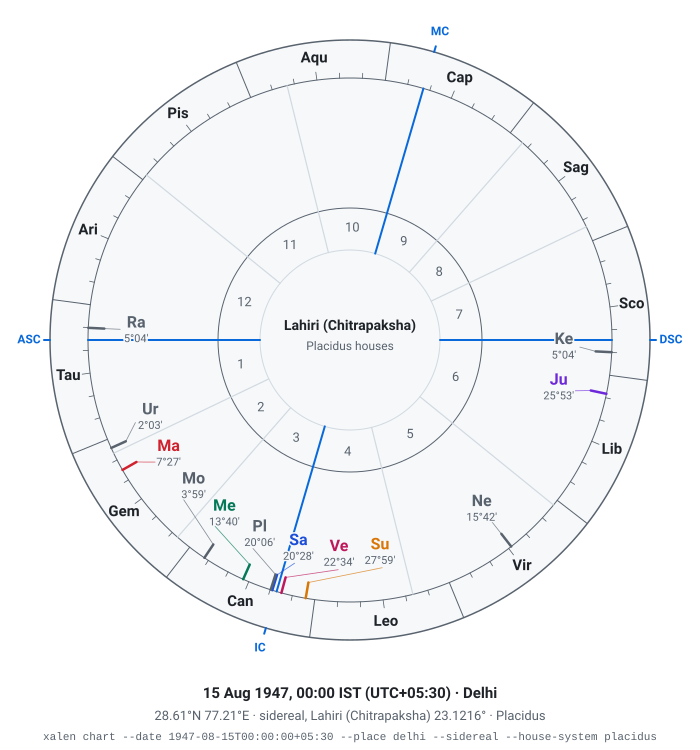
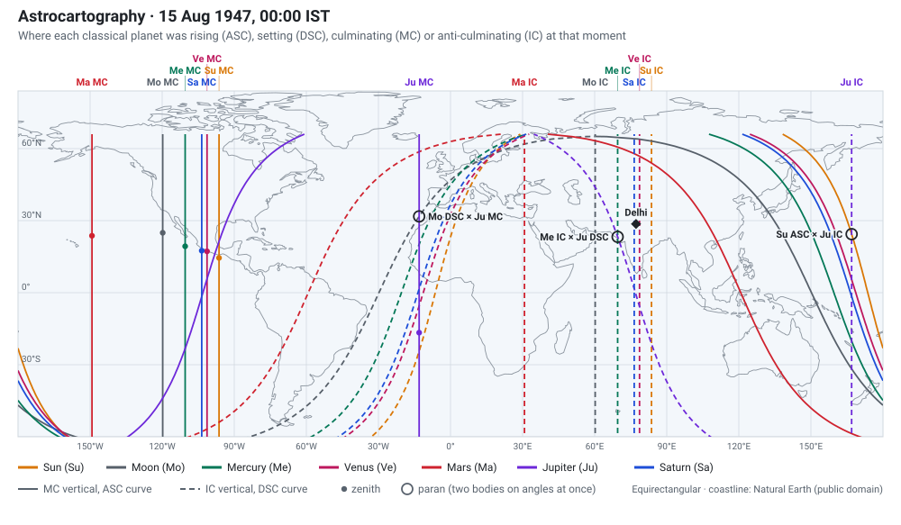
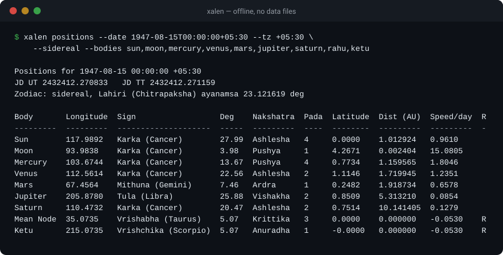
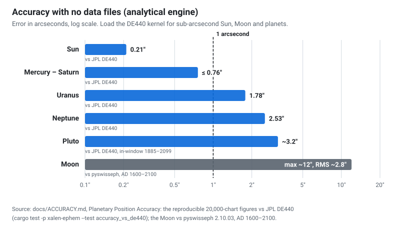

<p align="center">
  <picture>
    <source media="(prefers-color-scheme: dark)" srcset="docs/assets/logo-dark.svg">
    
  </picture>
</p>

<p align="center">
  <b>A pure-Rust astronomical ephemeris for astrology — JPL-class planet accuracy, zero <code>unsafe</code> core, Apache-2.0.</b>
</p>

<p align="center">
  <a href="https://crates.io/crates/xalen-ephemeris"></a>
  <a href="https://docs.rs/xalen-ephemeris"></a>
  <a href="https://pypi.org/project/xalen/"></a>
  <a href="https://www.npmjs.com/package/@xalen/wasm"></a>
  <a href="LICENSE"></a>
</p>

<p align="center">
  <a href="#get-started">Get started</a> ·
  <a href="#what-you-get">Features</a> ·
  <a href="#accuracy">Accuracy</a> ·
  <a href="docs/COMPARISON.md">Comparison</a> ·
  <a href="https://docs.rs/xalen-ephemeris">API docs</a>
</p>

XALEN Ephemeris computes planet positions, houses and ayanamsas, and the
techniques built on them for 12+ astrology traditions (Vedic, Western, Chinese
and more), from one pure-Rust core with Python, Node.js, WebAssembly and C
bindings and a command-line tool. The analytical engine needs no data files and
is sub-arcsecond against JPL DE440 for the Sun and Mercury to Saturn; load the
DE440 kernel and the Moon is sub-arcsecond too. It is validated against JPL
Horizons, Swiss Ephemeris and the public calculators, is thread-safe, has no
`unsafe` in the core crates, and is licensed Apache-2.0.

<table>
  <tr>
    <td width="42%" align="center"><picture><source media="(prefers-color-scheme: dark)" srcset="docs/assets/chart-wheel-dark.svg"></picture></td>
    <td width="58%" align="center"><picture><source media="(prefers-color-scheme: dark)" srcset="docs/assets/map-dark.svg"></picture></td>
  </tr>
  <tr>
    <td><sub><b>Chart wheel.</b> 15 August 1947, 00:00 IST (UTC+05:30), Delhi (28.6139° N, 77.209° E, built-in city table), sidereal Lahiri, Placidus houses: <code>xalen chart --date 1947-08-15T00:00:00+05:30 --place delhi --sidereal --house-system placidus --json</code></sub></td>
    <td><sub><b>Astrocartography.</b> The same moment: MC, IC, ascendant and descendant lines of the Sun to Saturn, their zenith points, and the three parans nearest Delhi's latitude: <code>xalen map --date 1947-08-15T00:00:00+05:30 --bodies sun,moon,mercury,venus,mars,jupiter,saturn --geojson --parans</code></sub></td>
  </tr>
</table>

<p align="center">
  
</p>

<sub>Every figure on this page is drawn from a real run by
[`scripts/readme-figures/generate.py`](scripts/readme-figures/generate.py);
run it from the repository root to reproduce them.</sub>

## Get started

**Rust** — `cargo add xalen-ephemeris`

```rust
use xalen_ephem::{Almanac, Body};
use xalen_time::{calendar_to_jd, CalendarSystem, JulianDay};
use xalen_ayanamsa::Ayanamsa;
use xalen_vedic::nakshatra::Nakshatra;

let jd = calendar_to_jd(1990, 3, 15, 12.0 - 5.5, CalendarSystem::default());
let almanac = Almanac::default_vedic();
let pos = almanac.geocentric_ecliptic(Body::Moon, jd).unwrap();
let sid = (pos.longitude.to_degrees() - Ayanamsa::Lahiri.compute_deg(jd.as_f64())).rem_euclid(360.0);
println!("{}", Nakshatra::from_longitude_deg(sid)); // Swati
```

The umbrella crate re-exports every sub-crate (`xalen_ephemeris::ephem`,
`::vedic`, `::time`, …); individual crates give a smaller footprint
([docs/CRATES.md](docs/CRATES.md)). Run `cargo run --example basic_chart` (also
`vedic_chart`, `western_chart`, `chinese_bazi`); more code is in
[docs/FEATURES.md](docs/FEATURES.md#more-code).

**Python** — `pip install xalen`

```python
import xalen

jd = xalen.julian_day(1990, 6, 15, 10.5)                            # 1990-06-15 10:30 UT
moon_sid = xalen.planet_position(jd, 1, sidereal=True, ayanamsa=0)  # Moon, Lahiri
nak = xalen.nakshatra(moon_sid["longitude"])
print(nak["name"], nak["pada"])
```

`import xalen.swe as swe` is a near-drop-in for `import swisseph as swe` for the
common calls; see [crates/xalen-python](crates/xalen-python/README.md).

**Node.js** — `npm install @xalen/ephemeris`

```js
const xalen = require('@xalen/ephemeris');
const p = xalen.planetPosition('sun', 2451545.0);  // J2000
console.log(p.longitude, p.isRetrograde);
```

The native addon is published to npm with each release from 0.8; until then
build it from source ([crates/xalen-node](crates/xalen-node/README.md)).

**Browser / WASM** — `npm install @xalen/wasm`

```js
import init, { XalenWasm } from "@xalen/wasm";
await init();
const w = new XalenWasm();
// Full Vedic chart for Pune (18.52 N, 73.85 E) at J2000, Lahiri ayanamsa (id 0).
const chart = JSON.parse(w.fullChartJson(2451545.0, 18.52, 73.85, 0));
```

**Command line** — `cargo install xalen-cli`

```bash
# Sidereal (Lahiri) positions with nakshatra and pada
xalen positions --date 2026-11-07T00:00:00Z --sidereal --bodies sun,moon

# Solar eclipses of 2024 as JSON (the 8 April total eclipse is the first)
xalen eclipses --from 2024-01-01 --to 2024-12-31 --type solar --json
```

Positions, charts, panchang, dasha, fixed stars, eclipses, rise and set times,
aspects, time conversions, astrocartography maps, synastry, composite, Davison
and relocated charts, as a table or with `--json`; offline, no data files. See
[crates/xalen-cli](crates/xalen-cli/README.md) for every command.

## What you get

<table>
  <tr>
    <td width="50%" valign="top"><b>Vedic / Jyotish</b><br>Dasha, shadbala, KP, Jaimini, Tajaka, panchang with tithi / nakshatra / yoga / karana transition times, compatibility, 16 divisional charts, yoga, dosha; <b>50 ayanamsa systems</b>, among them every Swiss Ephemeris ID (0-46) and a custom one.</td>
    <td width="50%" valign="top"><b>Western</b><br>Aspects, dignities, 97 Arabic Lots, Hellenistic, Uranian, Cosmobiology, progressions, exact solar and lunar returns, declination aspects and antiscia, harmonics, horary; <b>23 house systems</b> with Porphyry fallback at polar latitudes.</td>
  </tr>
  <tr>
    <td valign="top"><b>Chinese and world traditions</b><br>BaZi, Zi Wei Dou Shu, Feng Shui Flying Stars, Qi Men Dun Jia (experimental), Lal Kitab, I Ching (all 384 Legge line texts), numerology, Korean Saju, Nine Star Ki, Burmese Mahabote (day-sign profile only), Mayan, Aztec, Tibetan, Persian, Egyptian, Celtic.</td>
    <td valign="top"><b>Relationships and astrocartography</b><br>Synastry (aspect grid, house overlays), composite (Hand) and Davison charts, relocated charts; MC, IC, ascendant and descendant lines and zenith points for each body (Lewis), and parans (Brady).</td>
  </tr>
  <tr>
    <td valign="top"><b>Sky</b><br>9,096 Bright Star Catalogue stars and 503 named fixed stars with proper motion; 15 asteroids; Chiron, mean and true node, mean and true Black Moon Lilith; solar eclipses from Besselian elements with local C1–C4 contacts, lunar eclipses with umbral and penumbral magnitudes.</td>
    <td valign="top"><b>Engine and time</b><br>VSOP87A, ELP2000-82, IAU 2006/P03 precession and IAU 2000B nutation, a NAIF DE440 SPK reader; daily motion and retrograde flags, topocentric, equatorial, heliocentric and XYZ output; UT1 / TT / TDB, leap seconds, Stephenson–Morrison–Hohenkerk 2016 ΔT.</td>
  </tr>
  <tr>
    <td valign="top"><b>Output</b><br>SVG charts (North Indian diamond, South Indian box, Western wheel) with no external dependencies; names in 19 languages; geocoding for 130+ cities.</td>
    <td valign="top"><b>Bindings</b><br>Python (PyO3), Node.js (napi-rs), WebAssembly (wasm-bindgen) and C (<code>extern "C"</code>), each returning the full six-component position and speed with a retrograde flag.</td>
  </tr>
</table>

The complete list, with every caveat, is in [docs/FEATURES.md](docs/FEATURES.md).

## Accuracy

<p align="center">
  <picture>
    <source media="(prefers-color-scheme: dark)" srcset="docs/assets/accuracy-dark.svg">
    
  </picture>
</p>

Cross-checked against JPL Horizons DE440, the real DE440 binary kernel, the
official VSOP87 check file, Swiss Ephemeris and the public calculators
(astro.com, AstroSage, Drik Panchang, Prokerala, Jagannatha Hora). Figures from
[docs/ACCURACY.md](docs/ACCURACY.md):

| What | Measured | Against |
|------|----------|---------|
| Sun | **~0.21″** | JPL DE440, 20,000 charts |
| Mercury – Saturn | **≤ 0.76″** | JPL DE440, 20,000 charts |
| Uranus / Neptune | 1.78″ / 2.53″ | JPL DE440, 20,000 charts |
| Pluto (Goffin fit, 1885–2099) | ~3.2″ measured in-window; published Goffin bound ~1 arcminute | JPL DE440 |
| Moon (ELP2000-82, 60+60 terms) | RMS ~2.8″ (max ~12″) over AD 1600–2100 | pyswisseph 2.10.03 |
| Sun, Moon, planets with the DE440 kernel | sub-arcsecond apparent | JPL DE440 |
| Ayanamsas | 46 of 47 SE systems < 1″, one documented exception ≤ 2″ | Swiss Ephemeris |
| House systems | 18 of 19 comparable systems < 0.01° | Swiss Ephemeris |
| Lunar eclipses 1900–2100 | all 457 found, same type, no extra ones | pyswisseph 2.10.03 |

The DE440 kernel is optional: enable the `kernel-autodownload` feature and call
`De440Provider::from_auto_cache()` to fetch NASA's `de440s.bsp` once and reuse
it. How XALEN compares with Swiss Ephemeris, pyswisseph and other Rust crates is
in [docs/COMPARISON.md](docs/COMPARISON.md); moving from Swiss Ephemeris is
covered in [docs/MIGRATING_FROM_SWISS_EPH.md](docs/MIGRATING_FROM_SWISS_EPH.md).

## Bindings

| Language | Crate | Mechanism | Status |
|----------|-------|-----------|--------|
| **Rust** | `xalen-ephemeris` (umbrella) | Native | On crates.io |
| **C / C++** | `xalen-ffi` | `extern "C"` + `repr(C)` structs | Source-stable; on crates.io |
| **Python** | `xalen-python` | PyO3 | Alpha; on PyPI as `xalen` (`pip install xalen`) |
| **Node.js** | `xalen-node` | napi-rs native addon, prebuilt for Linux, macOS and Windows x64 | Alpha; on npm as `@xalen/ephemeris` with each release from 0.8, build from source until then |
| **Browser / WASM** | `xalen-wasm` | wasm-bindgen | Alpha; on npm as `@xalen/wasm` |

The integer IDs the bindings take are in [docs/BINDING_IDS.md](docs/BINDING_IDS.md);
the crate map and binding details are in [docs/CRATES.md](docs/CRATES.md).

## Architecture

Pure Rust with no C FFI dependencies in any core crate, and no `unsafe` outside
`xalen-ffi` (which needs it for `extern "C"`). No global state: all computation
goes through owned or `Arc<T>` references, and `Almanac` and all position types
are `Send + Sync`. Core crates target `wasm32-unknown-unknown`, DE440 stacks on
top of VSOP87 with automatic body and epoch fallback, and all data types derive
`Serialize` / `Deserialize`.

## Building

```bash
cargo build --release
cargo test                 # workspace default members; xalen-python is tested with maturin
bash scripts/gate.sh       # the full pre-merge gate: fmt, clippy, tests, docs, accuracy harness
```

The workflow, toolchain and every check are in [CONTRIBUTING.md](CONTRIBUTING.md);
the binding, WASM and benchmark builds are in [docs/CRATES.md](docs/CRATES.md#building).

## Project stats

- 24 crates in `crates/`, plus the umbrella crate and the `validation/` runner
- over 130,000 lines of Rust in 234 files, 168 of them library sources
- 2,447 tests passing, 0 failures (`cargo test --workspace --exclude xalen-python`)
- zero `unsafe` in the core crates' library code; only `xalen-ffi` uses it, for `extern "C"`

## License

Licensed under the [Apache License, Version 2.0](LICENSE).

```
Copyright 2024-2026 XALEN Technology Pvt Ltd.
```

For commercial licensing inquiries, contact [hello@xalen.io](mailto:hello@xalen.io).
"XALEN" and "XALEN Ephemeris" are trademarks of XALEN Technology Pvt Ltd; see
[TRADEMARK.md](TRADEMARK.md).

## Enterprise

XALEN Ephemeris is free and open source (Apache-2.0) — and always will be. For
production use that needs an **SLA, IP indemnification, a managed/hosted API,
certified-accuracy reports, white-label, or on-premise support**, see
**[ENTERPRISE.md](ENTERPRISE.md)** or reach us at **hello@xalen.io**. The
open-source core stays Apache-2.0; Enterprise only adds services and optional
proprietary modules on top.

## Contributing

Questions, bug reports and feature requests: see [SUPPORT.md](SUPPORT.md).

Contributions are welcome; please open an issue before starting significant
work. The path from issue to merged pull request (branch names, commit style,
checks, and the [contributor licence agreement](CLA.md)) is in
[CONTRIBUTING.md](CONTRIBUTING.md). In short: run `cargo test` and
`cargo clippy --workspace --exclude xalen-python -- -D warnings`, follow
`rustfmt` defaults, give every new astrological formula at least one
known-answer test against a published reference, and cite the textbook,
chapter and verse or page in code comments (Wikipedia and blog posts are not
acceptable sources for astrological algorithms).

Especially welcome: an expanded fixed star catalog, DE441 reader support, more
world tradition systems, documentation and examples, and cross-validation test
vectors against Swiss Ephemeris or JPL Horizons.
